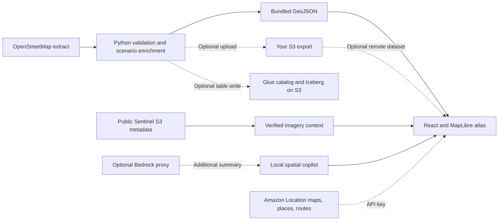

# TerraPulse Agentic Atlas

**A city. Two climates.** Explore Lahore through real place coordinates, transparent heat scenarios, and a spatial copilot that controls the map.

Built by **Muhammad Sheheryar**, BS Computer Science, University of Veterinary and Animal Sciences (UVAS), Lahore, for the AWS Builder Center **Weekend Challenge: Map it**.

- [Editable desktop and mobile Figma design](https://www.figma.com/design/7Qs4XTqMHkIIIJRReWqoOv)
- [Public map](https://shehar-e-yaar.github.io/terrapulse-atlas/) — deployment status is recorded in `submission/DELIVERY_STATUS.md`.
- [Source repository](https://github.com/shehar-e-yaar/terrapulse-atlas)
- [Submission write-up](submission/SUBMISSION_WRITEUP.md) · [120-second demo script](submission/DEMO_VIDEO_SCRIPT.md)

## Run it

Use Node.js 24 and Python 3.13 for the supplied checks.

```sh
npm ci
npm run dev
```

Open the local URL printed by Vite. No API key is required for the default experience. External vector tiles and fonts need internet access; the bundled place dataset and local copilot require no paid service.

```sh
npm test
npm run build
python pipeline/etl_to_s3_iceberg.py
```

## Explore

1. Ask **“Find a cooler place near Shahdara.”** The copilot parses the place, filters the dataset, ranks the nearest park and moves the map. Without AWS credentials, the connection is explicitly a straight-line estimate, not walking directions.
2. Try **“Compare industrial and canal temperatures”**, **“Show places with less than 10% canopy”**, **“Explore UVAS campus”**, **“temperature above 43”**, or **“temperatures below 38.”**
3. Toggle thermal density, clustered places, park candidates, and extruded scenario columns. Click clusters to zoom and separate their contents; click individual points to inspect them.
4. Flip the inspector with its code icon to reveal provenance. Source links point to OSM features or explicitly approximate curated anchors.
5. Play the four-stop spatial story or open **AWS architecture** and **Behind the data**.

The execution accordion displays actual application operations and elapsed wall time, including the short UI pacing interval. It does **not** expose private model reasoning or impersonate an Iceberg query. The default engine is a deterministic spatial tool orchestrator, not an LLM.

## Dataset and provenance

The starting dataset is a real OpenStreetMap extract retrieved from Overpass on **November 2, 2026**, with OSM base timestamp **2026-11-02T07:05:51Z**. The exact query is in `pipeline/fetch_osm.py`; the source response is retained in `pipeline/osm-places.json`.

The shipped set contains **797 distinct place records**, including **201 features tagged as parks**, plus ten manually curated approximate anchors covering UVAS, Shahdara, Mall Road, Gulberg, Canal Bank, Sundar, Kot Lakhpat and the Ravi riverfront. The final total already includes those anchors. Deduplication uses case-folded names, which can merge distinct places sharing a name; this is a small demo dataset, not an authoritative inventory. OSM park tags are community supplied and can be inconsistent. A park label does not verify public access or a cooling facility.

**Temperature, canopy percentage, vulnerability and risk are illustrative modeled inputs. There are zero sensor observations.** `pipeline/build_dataset.py` deterministically generates these values from category and SHA-256 of the record ID. It does not estimate real temperature, measure canopy, ingest air-quality stations, or infer population demographics. Category differences are constructed scenario assumptions; they are not discoveries about Lahore's observed environment. Every record carries `heat_kind: "modeled"` and `observed_at: null`.

| Field                                           | Meaning                                                           |
| ----------------------------------------------- | ----------------------------------------------------------------- |
| `id`, `name`, `coordinates`                     | Stable OSM/curated identity and longitude-latitude point          |
| `source_url`, `coordinate_quality`              | OSM feature URL or approximate manually curated anchor            |
| `kind`, `region`, `partition`                   | Demonstration grouping and north/central/south latitude partition |
| `temp_c`, `canopy_pct`, `vulnerability`, `risk` | Reproducible, explicitly synthetic environmental scenario         |
| `heat_kind`, `observed_at`                      | Modeled provenance and null observation timestamp                 |

Exports: `src/data/places.json`, `src/data/lahore.geojson`, `public/data/lahore.geojson`. `public/data/connections.json` holds precomputed geographic connections, not road routes. All interactive answers use the loaded records rather than canned numerical responses.

### Verified AWS data integration

`pipeline/fetch_aws_context.py` lists and downloads **real Sentinel-2 STAC scene metadata directly from the public Amazon S3 `sentinel-cogs` bucket in `us-west-2`**. It verifies that the scene bounding box contains central Lahore. The successful snapshot is retained as `pipeline/aws-scene-source.json` and `public/data/aws-context.json`. The in-app data/architecture panels display the scene ID, acquisition date, cloud cover, source link and live S3 verification status.

The chosen scene is **S2A_43RDQ_20240605_0_L2A**, acquired **June 5, 2024**, with **98.116308% cloud cover**. This deliberately exposes data quality rather than implying a usable cloud-free image. It is optical imagery context only. **No thermal or canopy values were derived from this scene.** It covers central Lahore, not every record in the wider dataset.

```sh
python pipeline/fetch_aws_context.py
```

This read-only public S3 step works without an AWS account and was executed successfully. Amazon Location, a private S3 warehouse, Glue/Iceberg writes, Bedrock, and Amplify hosting are separate optional integrations; their deployment is not implied by this verified S3 read.

## Architecture



React 18, TypeScript, Vite, Tailwind CSS, MapLibre GL JS 6, Framer Motion and Lucide. The original Figma design supplies the obsidian/glass palette, Space Grotesk headings, Inter interface text, JetBrains Mono telemetry, rounded containers and desktop/mobile hierarchy. The conceptual Figma map is implemented as live geospatial content.

### Amazon Location Service

Copy `.env.example` to `.env.local` and set a browser-appropriate Amazon Location API key and region. Rebuild after environment changes. The service module implements Maps V2, Places V2 SearchText and Routes V2 CalculateRoutes with simple geometry. Restrict the key's allowed APIs, HTTP referrers, expiry and budget. Never put IAM access keys or provider secrets in frontend variables.

The default map uses OpenFreeMap vector tiles with OSM attribution. The configured AWS map replaces this style. An unavailable route returns a labeled straight-line connection with no fabricated travel time. The nearest candidate is ranked by geographic distance; it is not guaranteed nearest by road or confirmed open.

### S3 and Apache Iceberg

Default ETL execution validates locally without cloud writes. With an existing bucket, suitable AWS credentials and `pipeline/requirements.txt` installed:

```sh
python pipeline/etl_to_s3_iceberg.py --bucket YOUR_BUCKET --region ap-south-1 --upload
python pipeline/etl_to_s3_iceberg.py --bucket YOUR_BUCKET --region ap-south-1 --iceberg
```

The optional Iceberg path uses the Glue catalog, geohash enrichment, typed Arrow records and a region partition. It overwrites the dedicated `terrapulse.lahore_scenario_v1` table snapshot to avoid duplicate rows on rerun. These cloud-write branches are included but were not executed without an AWS account configuration. Do not point the example at unrelated tables.

Set `VITE_SPATIAL_DATA_URL` to an HTTPS, CORS-enabled GeoJSON export URL. The app validates records and falls back to its bundled snapshot when the remote export fails. Keep the warehouse private; expose only the intended non-sensitive export through CloudFront or a scoped public data path. See `submission/AWS_DEPLOYMENT.md` for configuration.

### Optional live model

The optional Lambda in `server/bedrock_handler.py` uses Bedrock Converse. A protected endpoint implementing the same response contract can use Gemini or an OpenAI-compatible provider. Configure `VITE_AGENT_ENDPOINT`; the factual local answer and actions remain available if it fails. See `server/README.md`. Models generate a separately labeled summary, never executable map instructions.

## Deployment

`amplify.yml` installs, tests and builds the Vite app into `dist`. Connect this repository in AWS Amplify Hosting and supply optional environment variables there. AWS resources were not provisioned automatically without account access.

GitHub Pages hosts the public demo from a static `gh-pages` branch using `/terrapulse-atlas/` as the base path. Inactive workflow templates are included in `deployment/workflow-templates`; enabling them later requires GitHub workflow permission. Public S3 metadata access remains an AWS data integration regardless of frontend hosting. The write-up must identify the actual host and integrations honestly.

## Reuse with another city

1. Replace `src/data/places.json` with records matching `src/types.ts`, retaining source and observation provenance.
2. Update the map center and city labels, curated aliases and story stops.
3. Rebuild the GeoJSON exports and replace the imagery context with a scene that covers your city.
4. Run the tests and production build; optionally connect S3 and Amazon Location.

A schema-compatible dataset can be swapped quickly; validating a new city's coordinates, measurements and refuge access takes real research. The application does not claim that a new authoritative dataset can be produced in ten minutes.

## Sources and licenses

- [OpenStreetMap copyright and ODbL](https://www.openstreetmap.org/copyright): place extract and derived place database. Preserve attribution and applicable ODbL obligations when redistributing the database.
- [Sentinel-2 Cloud-Optimized GeoTIFFs, AWS Open Data](https://registry.opendata.aws/sentinel-2-l2a-cogs/), accessed November 2, 2026; original Copernicus terms apply to the imagery/metadata.
- [MapLibre installation and worker setup](https://maplibre.org/maplibre-gl-js/docs/), [Amazon Location API keys](https://docs.aws.amazon.com/location/latest/developerguide/using-apikeys.html), [PyIceberg configuration](https://py.iceberg.apache.org/configuration/).

Application code is MIT licensed. Data retains its source licenses. This prototype is for spatial exploration and scenario storytelling; it is not an emergency dispatch or medical routing system.

